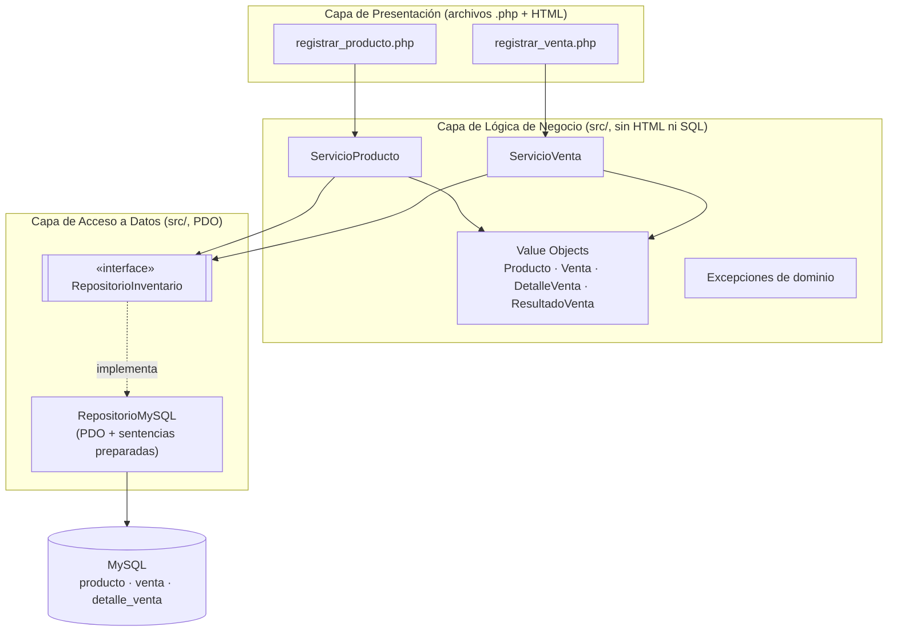
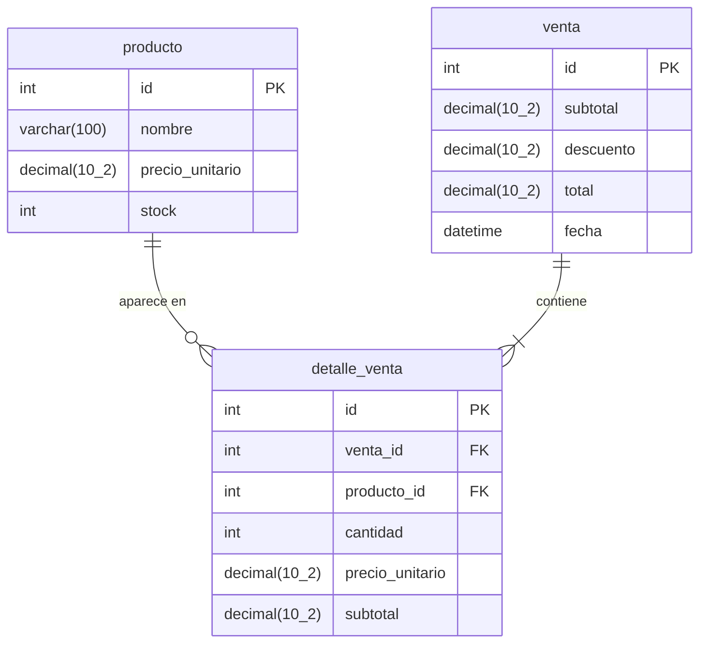

# Design Document — Registro de Ventas de la Bodega Doña Rosa

## Overview

El Sistema de Registro de Ventas de la Bodega Doña Rosa es una aplicación local (PHP 8 + MySQL sobre XAMPP, sin framework) que reemplaza el cuaderno manual de ventas. Permite a Doña Rosa registrar productos, registrar ventas, descontar el stock automáticamente y aplicar un descuento por volumen del 5 % cuando el subtotal supera S/ 100,00.

Esta versión **no** incluye gestión de usuarios/autenticación, reportes de ventas ni facturación electrónica.

### Objetivos del diseño

- **Separación en tres capas** (Presentación, Lógica de negocio, Acceso a datos) para un PHP sin framework, de modo que la lógica de negocio sea independiente del HTML y del SQL.
- **Testabilidad sin base de datos**: la clase `ServicioVenta` (y la validación de productos) debe poder ejecutarse con PHPUnit sin tocar MySQL. Esto se logra inyectando una interfaz de repositorio (`RepositorioInventario`) y usando un `RepositorioEnMemoria` (fake) en los tests.
- **Cálculo monetario exacto y determinista**: todos los importes se manejan internamente en céntimos enteros para evitar los errores de coma flotante de PHP y garantizar un redondeo *half-up* predecible.

### Reglas de negocio cubiertas

| Regla | Descripción | Dónde se valida |
|-------|-------------|-----------------|
| R1 | No vender más del stock disponible. Si cantidad == stock, la venta es válida y el stock queda en 0. | Lógica de negocio (`ServicioVenta.validarStock`) + validación atómica en el repositorio |
| R2 | Si subtotal > S/ 100,00 → 5 % de descuento. Si subtotal == S/ 100,00 → sin descuento. Redondeo half-up a 2 decimales. | Lógica de negocio (`ServicioVenta.calcularTotal`) |
| R3 | La cantidad debe ser un entero mayor que cero. Se rechazan 0, negativos y decimales. | Lógica de negocio (`ServicioVenta.validarCantidad`) |
| R4 | Al confirmar la venta, el stock de cada producto se reduce en la cantidad vendida, en la misma transacción. | Orquestado en lógica de negocio, ejecutado en acceso a datos (PDO) |

### Decisiones de diseño y su justificación

1. **Aritmética en céntimos enteros (no `float`)**. La función nativa `round()` de PHP usa por defecto `PHP_ROUND_HALF_UP`, pero sufre el conocido artefacto de coma flotante (`round(1.005, 2)` devuelve `1.0` en lugar de `1.01`). Para un cálculo monetario que debe redondear *half-up* de forma determinista, todo importe se representa internamente como un `int` de céntimos. El descuento se calcula con aritmética entera: `total_cents = floor((subtotal_cents * 190 + 100) / 200)` cuando `subtotal_cents > 10000`. Esto es exacto, predecible y fácil de property-testear. ([php.net round](https://www.php.net/manual/en/function.round.php), [php.watch rounding modes](https://php.watch/versions/8.4/round-new-modes))
2. **Interfaz de repositorio inyectada**. `ServicioVenta` depende de `RepositorioInventario` (interfaz), no de PDO. En producción se inyecta `RepositorioMySQL`; en tests, `RepositorioEnMemoria`. Así la lógica de negocio (R1, R2, R3 y la orquestación de R4) se prueba sin base de datos.
3. **Sin librerías externas salvo PHPUnit**. El testing de propiedades se implementa con `@dataProvider` de PHPUnit más un generador de entradas aleatorias ligero (≥ 100 iteraciones), en lugar de una librería PBT externa como Eris (que requeriría Composer). Se documenta esta adaptación en la estrategia de pruebas.
4. **Validación en el modelo (value objects)**. La validación de productos (Req 1) vive en el value object `Producto::crear(...)`, que es puro y testeable independientemente de la persistencia.

---

## Architecture

### Capas



**Capa de Presentación.** Archivos `.php` que mezclan HTML y PHP mínimo. Recogen formularios, llaman a los servicios y muestran mensajes de confirmación/error. No contienen SQL ni lógica de cálculo.

**Capa de Lógica de Negocio.** Clases en `src/` sin HTML ni SQL. `ServicioProducto` valida y persiste productos; `ServicioVenta` valida cantidades (R3), valida stock (R1), calcula subtotal/descuento/total (R2) y orquesta la transacción de stock (R4). Depende de la interfaz `RepositorioInventario`, nunca de PDO.

**Capa de Acceso a Datos.** `RepositorioMySQL` implementa `RepositorioInventario` con PDO y sentencias preparadas. Maneja `BEGIN`/`COMMIT`/`ROLLBACK`. Es la única capa que conoce MySQL.

### Flujo: registrar venta (con anotación de R1–R4 por capa)

```mermaid
sequenceDiagram
    autonumber
    participant U as Doña Rosa (Presentación)
    participant S as ServicioVenta (Lógica)
    participant R as RepositorioInventario (Datos)
    participant DB as MySQL

    Note over U: registrar_venta.php recoge ítems (producto_id, cantidad)
    U->>S: registrarVenta(items)

    Note over S: R3 · validarCantidad (entero > 0). Rechaza 0, negativos, decimales
    loop por cada ítem
        S->>S: validarCantidad(cantidad)
    end

    Note over S: R1 · leer stock y comparar cantidad vs stock
    loop por cada ítem
        S->>R: obtenerProducto(id)
        R->>DB: SELECT ... WHERE id = ? (prepared)
        DB-->>R: producto
        R-->>S: Producto
        S->>S: validarStock(cantidad, stock)
    end

    Note over S: R2 · calcular subtotal, descuento y total (céntimos, redondeo half-up)
    S->>S: calcularSubtotalCents() · calcularTotalCents()

    Note over S,R: R4 · abrir transacción
    S->>R: iniciarTransaccion()
    R->>DB: BEGIN
    loop por cada ítem
        S->>R: descontarStock(producto_id, cantidad)
        R->>DB: UPDATE producto SET stock = stock - ? WHERE id = ? AND stock >= ? (prepared)
        DB-->>R: filas afectadas
    end
    S->>R: guardarVenta(venta, detalles)
    R->>DB: INSERT venta; INSERT detalle_venta ... (prepared)
    Note over S,R: R4 · si ocurre error → revertir todo
    alt éxito
        S->>R: confirmar()
        R->>DB: COMMIT
        R-->>S: ok
        S-->>U: ResultadoVenta(total, venta_id)
    else error de stock o persistencia
        S->>R: revertir()
        R->>DB: ROLLBACK
        S-->>U: ExcepcionStockInsuficiente / ExcepcionPersistencia
    end
```

| Regla | Capa que la valida | Mecanismo |
|-------|--------------------|-----------|
| R1 | Lógica de negocio | `ServicioVenta.validarStock` (cantidad ≤ stock) + guard atómico `WHERE stock >= ?` en el UPDATE |
| R2 | Lógica de negocio | `ServicioVenta.calcularTotal` en céntimos enteros, redondeo half-up |
| R3 | Lógica de negocio | `ServicioVenta.validarCantidad` (entero > 0) |
| R4 | Lógica (orquestación) + Datos (ejecución) | `iniciarTransaccion`/`descontarStock`/`guardarVenta`/`confirmar`/`revertir` con PDO |

---

## Components and Interfaces

### Estructura de archivos

```
src/
  Producto.php                 # Value object (validación Req 1)
  Venta.php                     # Value object
  DetalleVenta.php              # Value object
  ResultadoVenta.php            # DTO de resultado
  ExcepcionDeValidacion.php     # Errores de entrada (precio, nombre, stock, cantidad)
  ExcepcionStockInsuficiente.php# R1 / R5.3
  ExcepcionPersistencia.php     # R5.2
  RepositorioInventario.php     # Interfaz
  RepositorioMySQL.php          # Implementación PDO
  RepositorioEnMemoria.php     # Fake para tests (sin BD)
  ServicioProducto.php          # Registrar producto (Req 1)
  ServicioVenta.php             # Lógica de ventas (Req 2-5)
registrar_producto.php          # Presentación
registrar_venta.php             # Presentación
config/conexion.php             # Crea PDO (DSN, usuario, contraseña)
sql/schema.sql                  # DDL de las 3 tablas
tests/
  ...                           # PHPUnit
```

> Nota: `phpunit.xml` ya existe con `bootstrap="src/ServicioVenta.php"`. El autoload de las clases se resuelve con `require_once` explícitos o un `spl_autoload_register` simple en el bootstrap, ya que no se usa Composer.

### Interfaces y firmas principales

```php
// src/RepositorioInventario.php
interface RepositorioInventario {
    /** Devuelve el producto o null si no existe. */
    public function obtenerProducto(int $id): ?Producto;

    /** Persiste un producto nuevo y devuelve el id asignado. */
    public function guardarProducto(Producto $producto): int;

    /**
     * Descuenta stock de forma atómica.
     * Lanza ExcepcionStockInsuficiente si stock < cantidad.
     */
    public function descontarStock(int $productoId, int $cantidad): void;

    /** Guarda la venta y sus detalles; devuelve el id de la venta. */
    public function guardarVenta(Venta $venta, array $detalles): int;

    public function iniciarTransaccion(): void;
    public function confirmar(): void;
    public function revertir(): void;
}
```

```php
// src/ServicioVenta.php  (sin HTML, sin SQL — testeable sin BD)
class ServicioVenta {
    public function __construct(private RepositorioInventario $repo) {}

    // --- Métodos PUROS (sin repositorio, sin BD) ---

    /** R3: lanza ExcepcionDeValidacion si la cantidad no es entero > 0. */
    public static function validarCantidad(mixed $cantidad): void;

    /** R1: lanza ExcepcionStockInsuficiente si cantidad > stock. */
    public static function validarStock(int $cantidad, int $stock): void;

    /** Subtotal en céntimos: Σ(precioCents * cantidad). */
    public static function calcularSubtotalCents(array $items): int;

    /** R2: total en céntimos (con descuento y redondeo half-up). */
    public static function calcularTotalCents(int $subtotalCents): int;

    /** Descuento en céntimos = subtotal - total. */
    public static function calcularDescuentoCents(int $subtotalCents): int;

    // --- Orquestación (usa el repo inyectado) ---

    /**
     * Req 2-5. Valida (R3, R1), calcula (R2), descuenta stock en
     * una transacción (R4). Devuelve ResultadoVenta o lanza excepción.
     */
    public function registrarVenta(array $items): ResultadoVenta;
}
```

```php
// src/Producto.php  (value object, validación Req 1)
final class Producto {
    private function __construct(
        public readonly int $id,
        public readonly string $nombre,
        public readonly int $precioCents,  // céntimos enteros
        public readonly int $stock
    ) {}

    /** Req 1.1–1.4: factory que valida y lanza ExcepcionDeValidacion. */
    public static function crear(
        string $nombre, int $precioCents, int $stock, int $id = 0
    ): self;
}
```

### Contrato de `registrarVenta` (orquestación, R4)

1. Validar que hay entre 1 y 100 ítems (Req 2.1).
2. Por cada ítem, `validarCantidad` (R3). Si alguno es inválido, lanzar `ExcepcionDeValidacion` **sin tocar la BD**.
3. Por cada ítem, `obtenerProducto` + `validarStock` (R1). Si alguno excede el stock, lanzar `ExcepcionStockInsuficiente` **sin tocar la BD**.
4. Calcular subtotal, total y descuento (R2).
5. `iniciarTransaccion()` → por cada ítem `descontarStock` → `guardarVenta` → `confirmar()`. Si cualquier paso lanza, `revertir()` y propagar `ExcepcionPersistencia` con mensaje "La venta no se completó" (R5.2).
6. Devolver `ResultadoVenta(ventaId, subtotal, descuento, total)`.

---

## Data Models

### Modelo relacional



### DDL (`sql/schema.sql`)

```sql
CREATE TABLE producto (
    id              INT          NOT NULL AUTO_INCREMENT,
    nombre          VARCHAR(100) NOT NULL,
    precio_unitario DECIMAL(10,2) NOT NULL,        -- > 0
    stock           INT          NOT NULL DEFAULT 0, -- >= 0
    CONSTRAINT pk_producto PRIMARY KEY (id),
    CONSTRAINT chk_precio_positivo CHECK (precio_unitario > 0),
    CONSTRAINT chk_stock_no_negativo CHECK (stock >= 0)
) ENGINE=InnoDB;

CREATE TABLE venta (
    id        INT           NOT NULL AUTO_INCREMENT,
    subtotal  DECIMAL(10,2) NOT NULL,
    descuento DECIMAL(10,2) NOT NULL DEFAULT 0,
    total     DECIMAL(10,2) NOT NULL,
    fecha     DATETIME      NOT NULL DEFAULT CURRENT_TIMESTAMP,
    CONSTRAINT pk_venta PRIMARY KEY (id)
) ENGINE=InnoDB;

CREATE TABLE detalle_venta (
    id              INT           NOT NULL AUTO_INCREMENT,
    venta_id        INT           NOT NULL,
    producto_id     INT           NOT NULL,
    cantidad        INT           NOT NULL,        -- > 0
    precio_unitario DECIMAL(10,2) NOT NULL,        -- snapshot del precio al vender
    subtotal        DECIMAL(10,2) NOT NULL,
    CONSTRAINT pk_detalle PRIMARY KEY (id),
    CONSTRAINT fk_detalle_venta    FOREIGN KEY (venta_id)    REFERENCES venta(id)    ON DELETE RESTRICT,
    CONSTRAINT fk_detalle_producto FOREIGN KEY (producto_id) REFERENCES producto(id) ON DELETE RESTRICT,
    CONSTRAINT chk_cantidad_positiva CHECK (cantidad > 0)
) ENGINE=InnoDB;
```

### Decisiones del modelo

- **`DECIMAL(10,2)`** en la base para legibilidad humana; el repositorio convierte a/desde céntimos enteros al pasarlo al servicio. Así el servicio opera solo con `int` y la BD sigue siendo inspeccionable.
- **`precio_unitario` en `detalle_venta`** es un *snapshot* del precio al momento de la venta, para que el histórico no cambie si luego se modifica el precio del producto.
- **`ENGINE=InnoDB`** para soportar transacciones (R4) y claves foráneas.
- **`CHECK`** en la BD como defensa adicional (precio > 0, stock ≥ 0, cantidad > 0); la validación autoritativa vive en la lógica de negocio, pero las restricciones de BD evitan datos inconsistentes si se accede por otra vía.

---

## Correctness Properties

*A property is a characteristic or behavior that should hold true across all valid executions of a system — essentially, a formal statement about what the system should do. Properties serve as the bridge between human-readable specifications and machine-verifiable correctness guarantees.*

Evaluación de PBT: **APLICA**. La lógica pura del sistema —validación de producto (Req 1), validación de cantidad (R3), validación de stock (R1), cálculo de descuento y redondeo (R2), y la orquestación transaccional con un repositorio en memoria (R4)— son funciones con entrada/salida clara y propiedades universales que se cumplen en un espacio amplio de entradas. Las partes de integración (persistencia real en MySQL, id autoincremental, ejecución de `BEGIN/COMMIT`) se cubren con tests de integración de 1–2 ejemplos, no con PBT.

### Property 1: Creación de producto preserva entradas válidas

*For any* nombre con longitud entre 1 y 100 (tras recortar), precio en céntimos > 0 y stock entero ≥ 0, `Producto::crear` devuelve un producto cuyos campos coinciden con las entradas.

**Validates: Requirements 1.1**

### Property 2: Precio no positivo es rechazado

*For any* precio en céntimos ≤ 0 (incluyendo cero y negativos), `Producto::crear` lanza `ExcepcionDeValidacion`.

**Validates: Requirements 1.2**

### Property 3: Nombre vacío o demasiado largo es rechazado

*For any* cadena cuyo nombre, tras recortar, tenga longitud 0 o mayor a 100, `Producto::crear` lanza `ExcepcionDeValidacion`.

**Validates: Requirements 1.3**

### Property 4: Stock no entero no negativo es rechazado

*For any* entrada de stock que no sea un entero mayor o igual a cero (negativos, decimales y no numéricos), `Producto::crear` lanza `ExcepcionDeValidacion`.

**Validates: Requirements 1.4**

### Property 5: Conteo de ítems de venta dentro de límites

*For any* conjunto de ítems de venta, la venta se acepta únicamente si el número de ítems está entre 1 y 100; con 0 o más de 100 ítems se rechaza con `ExcepcionDeValidacion`.

**Validates: Requirements 2.1**

### Property 6: Cantidad inválida es rechazada

*For any* cantidad que no sea un entero mayor que cero (cero, negativos y decimales), `ServicioVenta::validarCantidad` lanza `ExcepcionDeValidacion`.

**Validates: Requirements 2.2**

### Property 7: Comportamiento integral de validación de stock

*For any* producto con stock `S` y cantidad solicitada `Q`: si `Q > S` la venta se rechaza y el stock queda en `S`; si `Q == S` la venta se permite y el stock queda en `0`; si `Q < S` la venta se permite y el stock queda en `S - Q`.

**Validates: Requirements 3.1, 3.2**

### Property 8: Cálculo integral de descuento y redondeo

*For any* subtotal en céntimos `s`: si `s > 10000` el total es `floor((s * 190 + 100) / 200)` (redondeo half-up a céntimos) y el descuento es `s - total`; si `s == 10000` el total es `10000` y el descuento es `0`; y en todo caso `total = subtotal - descuento` se cumple exactamente.

**Validates: Requirements 4.1, 4.2**

### Property 9: El stock se descuenta correctamente al confirmar

*For any* venta válida confirmada contra un repositorio en memoria, el stock final de cada producto es `stock_inicial - cantidad` y el repositorio registró exactamente una llamada a `iniciarTransaccion` y una a `confirmar`.

**Validates: Requirements 5.1**

### Property 10: El fallo durante el descuento revierte todo

*For any* venta válida y cualquier posición de fallo en la secuencia de `descontarStock`, si el repositorio falla al descontar el stock de algún producto, ningún stock se modifica, no se guarda la venta y se invoca `revertir`.

**Validates: Requirements 5.2**

### Property 11: Stock insuficiente no provoca modificaciones parciales

*For any* venta con al menos un producto cuyo stock es insuficiente, tras el intento de `registrarVenta` ningún stock se modifica y no se guarda ninguna venta.

**Validates: Requirements 5.3**

---

## Error Handling

| Escenario | Excepción / mensaje | Acción | Requisito |
|-----------|---------------------|--------|-----------|
| Precio ≤ 0 | `ExcepcionDeValidacion` — "El precio unitario debe ser mayor que cero" | No guardar producto | 1.2 |
| Nombre vacío o > 100 | `ExcepcionDeValidacion` — "El nombre debe tener entre 1 y 100 caracteres" | No guardar producto | 1.3 |
| Stock negativo, decimal o no numérico | `ExcepcionDeValidacion` — "El stock inicial debe ser un entero mayor o igual a cero" | No guardar producto | 1.4 |
| Cantidad 0, negativa o decimal | `ExcepcionDeValidacion` — "La cantidad debe ser un entero mayor que cero" | Rechazar venta antes de tocar la BD | 2.2 (R3) |
| Cantidad > stock | `ExcepcionStockInsuficiente` — "Stock disponible: S" (menciona el producto) | Rechazar venta, stock sin cambios | 3.1 (R1) |
| Error al actualizar stock | `ExcepcionPersistencia` — "La venta no se completó" | `ROLLBACK`, consistencia del inventario preservada | 5.2 (R4) |
| Stock insuficiente al confirmar | `ExcepcionStockInsuficiente` — indica qué producto no tiene stock | Rechazar venta completa, ningún stock modificado | 5.3 (R1, R4) |
| Producto inexistente en la venta | `ExcepcionDeValidacion` — "Producto no encontrado: id" | Rechazar venta | (deriva de 2.1/3.1) |
| Error de conexión PDO | `ExcepcionPersistencia` | Propagar a presentación; no registrar venta | (operación) |

Principios:
- **Fallos rápidos en la lógica de negocio**: las validaciones de R1 y R3 ocurren *antes* de abrir la transacción, así una venta inválida nunca toca la BD.
- **Atomicidad**: cualquier excepción dentro de la transacción dispara `revertir()` para cumplir R4 (consistencia del inventario).
- **Mensajes orientados a Doña Rosa**: textos claros en español, mostrados en la capa de presentación; las excepciones de dominio llevan el mensaje, no el SQL ni trazas técnicas.

---

## Testing Strategy

### Enfoque dual

- **Tests unitarios (PHPUnit)**: ejemplos concretos, casos límite y errores. Verifican mensajes exactos, límites (100 vs 101, 100.00 vs 100.01, Q == S vs Q == S+1) y puntos de integración.
- **Tests de propiedades (estilo PBT con `@dataProvider`)**: verifican las 11 propiedades universales sobre entradas aleatorias, con un mínimo de 100 iteraciones por propiedad.

### Testabilidad sin base de datos (requisito clave)

`ServicioVenta` depende de la interfaz `RepositorioInventario`. En los tests se inyecta `RepositorioEnMemoria`, un fake que guarda productos y ventas en arreglos PHP y simula transacciones (banderas `txnActiva`, contador de `revertir`, posibilidad de fallar en el N-ésimo `descontarStock`). Con esto se prueba R1, R2, R3 y la orquestación de R4 (iniciar/descontar/guardar/confirmar/revertir) **sin MySQL**.

`RepositorioMySQL` se prueba aparte con tests de integración contra una BD de prueba en XAMPP.

### Property-Based Testing — adaptación a la restricción "sin librerías externas"

PBT es apropiado para la lógica pura (descuento/redondeo, validaciones, comportamiento de stock). Sin embargo, las librerías PBT de PHP (p. ej. [Eris](https://github.com/giokara/Eris), [steos/php-quickcheck](https://github.com/steos/php-quickcheck)) requieren Composer, prohibido por la restricción "sin librerías externas salvo PHPUnit".

**Decisión**: implementar las propiedades con el `@dataProvider` nativo de PHPUnit más un generador de entradas aleatorias ligero (funciones puras que producen nombres, precios, stocks, cantidades, ventas). Cada test de propiedad se ejecuta ≥ 100 iteraciones. Esto cumple el objetivo del PBT (cubrir un amplio espacio de entradas y encontrar casos límite) sin añadir dependencias. Si en el futuro se relajara la restricción, migrar a Eris sería directo y se mantiene la misma semántica de propiedades.

Cada test de propiedad se etiqueta con un comentario:
`/** Feature: bodega-sales-registration, Property N: <texto de la propiedad> */`

### Distribución de tests

| Tipo | Objetivo | Cantidad | Sin BD |
|------|----------|----------|--------|
| Unitarios de validación (Producto, ServicioVenta puro) | Ejemplos + límites + mensajes | ~20 | Sí |
| Propiedades (1–11) con `@dataProvider`, ≥ 100 iteraciones | Universales | 11 | Sí (repo en memoria) |
| Integración (`RepositorioMySQL`) | Persistencia real, id, transacción BEGIN/COMMIT/ROLLBACK | 6–8 | No (BD de prueba) |

### Tests de integración (1–2 ejemplos por caso, contra MySQL de prueba en XAMPP)

- Guardar producto → verificar `id` autoincremental único y lectura coherente.
- Registrar venta válida → verificar `venta` + `detalle_venta` insertados y stock decrementado.
- Registrar venta con stock insuficiente → verificar que no se inserta nada y el stock no cambia.
- Forzar error a mitad de la transacción (p. ej. desconectar o violar restricción) → verificar `ROLLBACK` y consistencia.

Estos usan una base de datos de prueba (esquema separado o tabla prefijada) que se reinicia entre pruebas, o una transacción de prueba que se revierte al final de cada test.

### Cobertura de requisitos

| Requisito | Tests |
|-----------|-------|
| 1.1 | Property 1 + integración (id único) |
| 1.2 | Property 2 + unitario (mensaje, límite 0) |
| 1.3 | Property 3 + unitario (límites 100/101, solo-espacios) |
| 1.4 | Property 4 + unitario ("-1", "3.5", "abc") |
| 2.1 | Property 5 + integración (registro) |
| 2.2 (R3) | Property 6 + unitario (mensaje) |
| 3.1 (R1) | Property 7 + unitario (mensaje muestra stock) |
| 3.2 (R1) | Property 7 (caso Q == S) |
| 4.1 (R2) | Property 8 + unitario (empates .xx5) |
| 4.2 (R2) | Property 8 (caso 100.00) |
| 5.1 (R4) | Property 9 + integración (COMMIT) |
| 5.2 (R4) | Property 10 + integración (ROLLBACK) |
| 5.3 (R1, R4) | Property 11 + integración |
